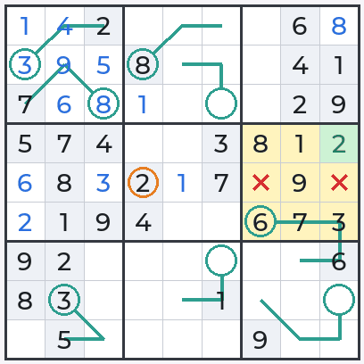

<!-- Written by tools/walkthrough.py average-lines: edit the script, not this page. -->
# Average Lines, step 14: the 2 in box 6

**Step 14 of 49** · [← Step 13](step-13.md) · [All steps](../average-lines.md#the-whole-puzzle-step-by-step) · [Step 15 →](step-15.md)

Box 6 needs a 2. r5c7 and r5c9: row 5 has one (r5c4). Only **r4c9** is left: **r4c9 = 2**.

**Step 14 of 49** · [← Step 13](step-13.md) · [All steps](../average-lines.md#the-whole-puzzle-step-by-step) · [Step 15 →](step-15.md)
