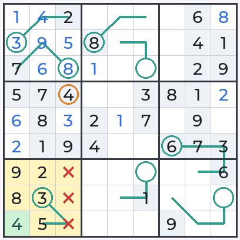

<!-- Written by tools/walkthrough.py average-lines: edit the script, not this page. -->
# Average Lines, step 15: the 4 in box 7

**Step 15 of 49** · [← Step 14](step-14.md) · [All steps](../average-lines.md#the-whole-puzzle-step-by-step) · [Step 16 →](step-16.md)

Box 7 needs a 4. r7c3, r8c3 and r9c3: column 3 has one (r4c3). Only **r9c1** is left: **r9c1 = 4**.

**Step 15 of 49** · [← Step 14](step-14.md) · [All steps](../average-lines.md#the-whole-puzzle-step-by-step) · [Step 16 →](step-16.md)
