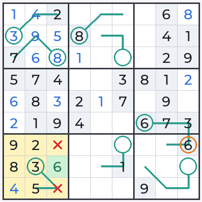

<!-- Written by tools/walkthrough.py average-lines: edit the script, not this page. -->
# Average Lines, step 16: the 6 in box 7

**Step 16 of 49** · [← Step 15](step-15.md) · [All steps](../average-lines.md#the-whole-puzzle-step-by-step) · [Step 17 →](step-17.md)

Box 7 needs a 6. r7c3: row 7 has one (r7c9). r9c3: the circle 3 times its 2 other cells is 6, and the rest make 5, so it's 1. Only **r8c3** is left: **r8c3 = 6**.

**Step 16 of 49** · [← Step 15](step-15.md) · [All steps](../average-lines.md#the-whole-puzzle-step-by-step) · [Step 17 →](step-17.md)
