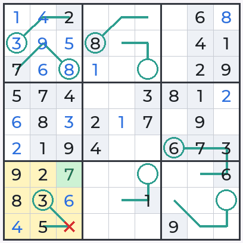

<!-- Written by tools/walkthrough.py average-lines: edit the script, not this page. -->
# Average Lines, step 17: the 7 in box 7

**Step 17 of 49** · [← Step 16](step-16.md) · [All steps](../average-lines.md#the-whole-puzzle-step-by-step) · [Step 18 →](step-18.md)

Box 7 needs a 7. r9c3: the circle 3 times its 2 other cells is 6, and the rest make 5, so it's 1. Only **r7c3** is left: **r7c3 = 7**.

**Step 17 of 49** · [← Step 16](step-16.md) · [All steps](../average-lines.md#the-whole-puzzle-step-by-step) · [Step 18 →](step-18.md)
