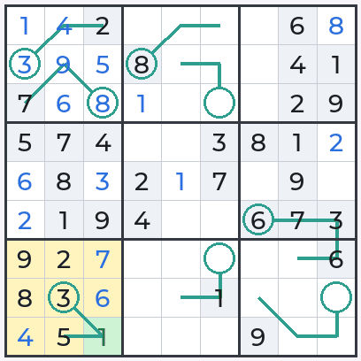

<!-- Written by tools/walkthrough.py average-lines: edit the script, not this page. -->
# Average Lines, step 18: the 1 in box 7

**Step 18 of 49** · [← Step 17](step-17.md) · [All steps](../average-lines.md#the-whole-puzzle-step-by-step) · [Step 19 →](step-19.md)

Box 7 needs a 1, and r9c3 is its last empty cell: **r9c3 = 1**.

**Step 18 of 49** · [← Step 17](step-17.md) · [All steps](../average-lines.md#the-whole-puzzle-step-by-step) · [Step 19 →](step-19.md)
