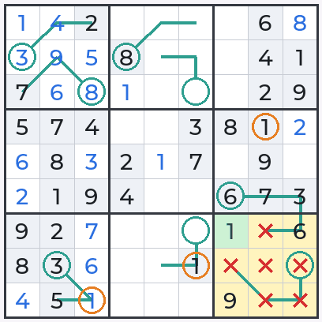

<!-- Written by tools/walkthrough.py average-lines: edit the script, not this page. -->
# Average Lines, step 19: the 1 in box 9

**Step 19 of 49** · [← Step 18](step-18.md) · [All steps](../average-lines.md#the-whole-puzzle-step-by-step) · [Step 20 →](step-20.md)

Box 9 needs a 1. r7c8: column 8 has one (r4c8). r8c7, r8c8 and r8c9: row 8 has one (r8c6). r9c8 and r9c9: row 9 has one (r9c3). Only **r7c7** is left: **r7c7 = 1**.

**Step 19 of 49** · [← Step 18](step-18.md) · [All steps](../average-lines.md#the-whole-puzzle-step-by-step) · [Step 20 →](step-20.md)
