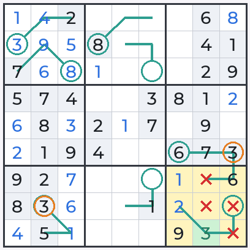

<!-- Written by tools/walkthrough.py average-lines: edit the script, not this page. -->
# Average Lines, step 21: the 3 in box 9

**Step 21 of 49** · [← Step 20](step-20.md) · [All steps](../average-lines.md#the-whole-puzzle-step-by-step) · [Step 22 →](step-22.md)

Box 9 needs a 3. r8c8 and r8c9: row 8 has one (r8c2). r9c9: column 9 has one (r6c9). r7c8: the circle 6 times its 4 other cells is 24, and the rest make 16, so it's 8. Only **r9c8** is left: **r9c8 = 3**.

**Step 21 of 49** · [← Step 20](step-20.md) · [All steps](../average-lines.md#the-whole-puzzle-step-by-step) · [Step 22 →](step-22.md)
