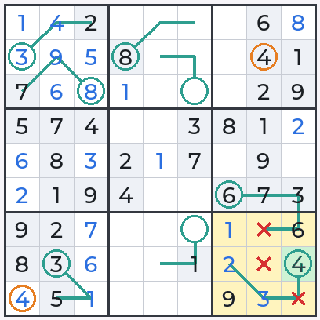

<!-- Written by tools/walkthrough.py average-lines: edit the script, not this page. -->
# Average Lines, step 22: the 4 in box 9

**Step 22 of 49** · [← Step 21](step-21.md) · [All steps](../average-lines.md#the-whole-puzzle-step-by-step) · [Step 23 →](step-23.md)

Box 9 needs a 4. r7c8 and r8c8: column 8 has one (r2c8). r9c9: row 9 has one (r9c1). Only **r8c9** is left: **r8c9 = 4**.

**Step 22 of 49** · [← Step 21](step-21.md) · [All steps](../average-lines.md#the-whole-puzzle-step-by-step) · [Step 23 →](step-23.md)
