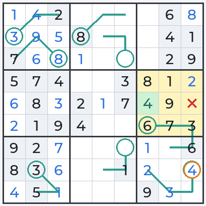

<!-- Written by tools/walkthrough.py average-lines: edit the script, not this page. -->
# Average Lines, step 23: the 4 in box 6

**Step 23 of 49** · [← Step 22](step-22.md) · [All steps](../average-lines.md#the-whole-puzzle-step-by-step) · [Step 24 →](step-24.md)

Box 6 needs a 4. r5c9: column 9 has one (r8c9). Only **r5c7** is left: **r5c7 = 4**.

**Step 23 of 49** · [← Step 22](step-22.md) · [All steps](../average-lines.md#the-whole-puzzle-step-by-step) · [Step 24 →](step-24.md)
