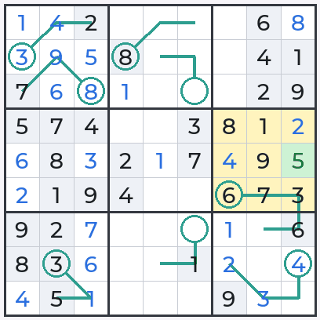

<!-- Written by tools/walkthrough.py average-lines: edit the script, not this page. -->
# Average Lines, step 24: the 5 in box 6

**Step 24 of 49** · [← Step 23](step-23.md) · [All steps](../average-lines.md#the-whole-puzzle-step-by-step) · [Step 25 →](step-25.md)

Box 6 needs a 5, and r5c9 is its last empty cell: **r5c9 = 5**.

**Step 24 of 49** · [← Step 23](step-23.md) · [All steps](../average-lines.md#the-whole-puzzle-step-by-step) · [Step 25 →](step-25.md)
