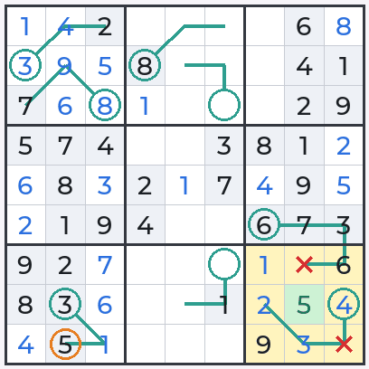

<!-- Written by tools/walkthrough.py average-lines: edit the script, not this page. -->
# Average Lines, step 25: the 5 in box 9

**Step 25 of 49** · [← Step 24](step-24.md) · [All steps](../average-lines.md#the-whole-puzzle-step-by-step) · [Step 26 →](step-26.md)

Box 9 needs a 5. r9c9: row 9 has one (r9c2). r7c8: the circle 6 times its 4 other cells is 24, and the rest make 16, so it's 8. Only **r8c8** is left: **r8c8 = 5**.

**Step 25 of 49** · [← Step 24](step-24.md) · [All steps](../average-lines.md#the-whole-puzzle-step-by-step) · [Step 26 →](step-26.md)
