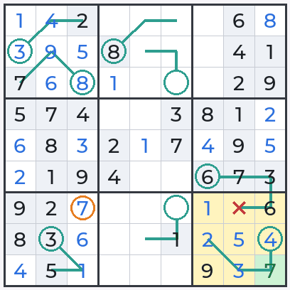

<!-- Written by tools/walkthrough.py average-lines: edit the script, not this page. -->
# Average Lines, step 26: the 7 in box 9

**Step 26 of 49** · [← Step 25](step-25.md) · [All steps](../average-lines.md#the-whole-puzzle-step-by-step) · [Step 27 →](step-27.md)

Box 9 needs a 7. r7c8: row 7 has one (r7c3). Only **r9c9** is left: **r9c9 = 7**.

**Step 26 of 49** · [← Step 25](step-25.md) · [All steps](../average-lines.md#the-whole-puzzle-step-by-step) · [Step 27 →](step-27.md)
