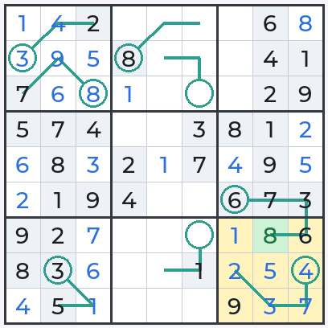

<!-- Written by tools/walkthrough.py average-lines: edit the script, not this page. -->
# Average Lines, step 27: the 8 in box 9

**Step 27 of 49** · [← Step 26](step-26.md) · [All steps](../average-lines.md#the-whole-puzzle-step-by-step) · [Step 28 →](step-28.md)

Box 9 needs an 8, and r7c8 is its last empty cell: **r7c8 = 8**.

**Step 27 of 49** · [← Step 26](step-26.md) · [All steps](../average-lines.md#the-whole-puzzle-step-by-step) · [Step 28 →](step-28.md)
