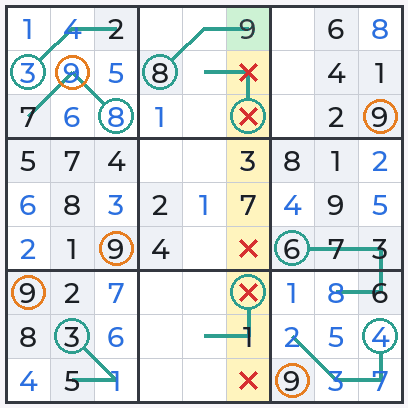

<!-- Written by tools/walkthrough.py average-lines: edit the script, not this page. -->
# Average Lines, step 28: the 9 in column 6

**Step 28 of 49** · [← Step 27](step-27.md) · [All steps](../average-lines.md#the-whole-puzzle-step-by-step) · [Step 29 →](step-29.md)

Column 6 needs a 9. r2c6: row 2 has one (r2c2). r3c6: row 3 has one (r3c9). r6c6: row 6 has one (r6c3). r7c6: row 7 has one (r7c1). r9c6: row 9 has one (r9c7). Only **r1c6** is left: **r1c6 = 9**.

**Step 28 of 49** · [← Step 27](step-27.md) · [All steps](../average-lines.md#the-whole-puzzle-step-by-step) · [Step 29 →](step-29.md)
