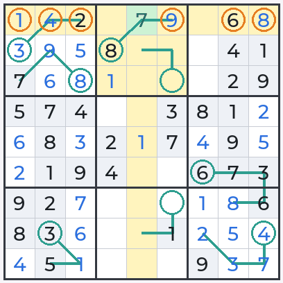

<!-- Written by tools/walkthrough.py average-lines: edit the script, not this page. -->
# Average Lines, step 29: r1c5

**Step 29 of 49** · [← Step 28](step-28.md) · [All steps](../average-lines.md#the-whole-puzzle-step-by-step) · [Step 30 →](step-30.md)

Row 1 has 1, 2, 4, 6, 8 and 9. Not 3 or 5: the circle 8 times its 2 other cells is 16, and the rest make 9, so it's 7. Only 7 is left: **r1c5 = 7**.

**Step 29 of 49** · [← Step 28](step-28.md) · [All steps](../average-lines.md#the-whole-puzzle-step-by-step) · [Step 30 →](step-30.md)
