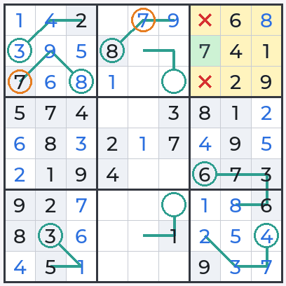

<!-- Written by tools/walkthrough.py average-lines: edit the script, not this page. -->
# Average Lines, step 30: the 7 in box 3

**Step 30 of 49** · [← Step 29](step-29.md) · [All steps](../average-lines.md#the-whole-puzzle-step-by-step) · [Step 31 →](step-31.md)

Box 3 needs a 7. r1c7: row 1 has one (r1c5). r3c7: row 3 has one (r3c1). Only **r2c7** is left: **r2c7 = 7**.

**Step 30 of 49** · [← Step 29](step-29.md) · [All steps](../average-lines.md#the-whole-puzzle-step-by-step) · [Step 31 →](step-31.md)
