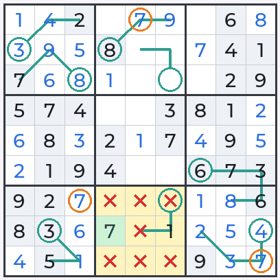

<!-- Written by tools/walkthrough.py average-lines: edit the script, not this page. -->
# Average Lines, step 31: the 7 in box 8

**Step 31 of 49** · [← Step 30](step-30.md) · [All steps](../average-lines.md#the-whole-puzzle-step-by-step) · [Step 32 →](step-32.md)

Box 8 needs a 7. r7c4, r7c5 and r7c6: row 7 has one (r7c3). r8c5: column 5 has one (r1c5). r9c4, r9c5 and r9c6: row 9 has one (r9c9). Only **r8c4** is left: **r8c4 = 7**.

**Step 31 of 49** · [← Step 30](step-30.md) · [All steps](../average-lines.md#the-whole-puzzle-step-by-step) · [Step 32 →](step-32.md)
