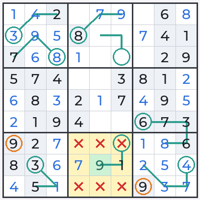

<!-- Written by tools/walkthrough.py average-lines: edit the script, not this page. -->
# Average Lines, step 32: the 9 in box 8

**Step 32 of 49** · [← Step 31](step-31.md) · [All steps](../average-lines.md#the-whole-puzzle-step-by-step) · [Step 33 →](step-33.md)

Box 8 needs a 9. r7c4, r7c5 and r7c6: row 7 has one (r7c1). r9c4, r9c5 and r9c6: row 9 has one (r9c7). Only **r8c5** is left: **r8c5 = 9**.

**Step 32 of 49** · [← Step 31](step-31.md) · [All steps](../average-lines.md#the-whole-puzzle-step-by-step) · [Step 33 →](step-33.md)
