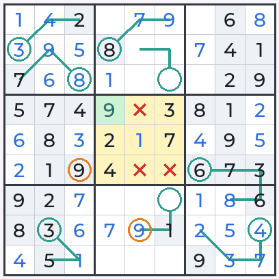

<!-- Written by tools/walkthrough.py average-lines: edit the script, not this page. -->
# Average Lines, step 33: the 9 in box 5

**Step 33 of 49** · [← Step 32](step-32.md) · [All steps](../average-lines.md#the-whole-puzzle-step-by-step) · [Step 34 →](step-34.md)

Box 5 needs a 9. r4c5: column 5 has one (r8c5). r6c5 and r6c6: row 6 has one (r6c3). Only **r4c4** is left: **r4c4 = 9**.

**Step 33 of 49** · [← Step 32](step-32.md) · [All steps](../average-lines.md#the-whole-puzzle-step-by-step) · [Step 34 →](step-34.md)
