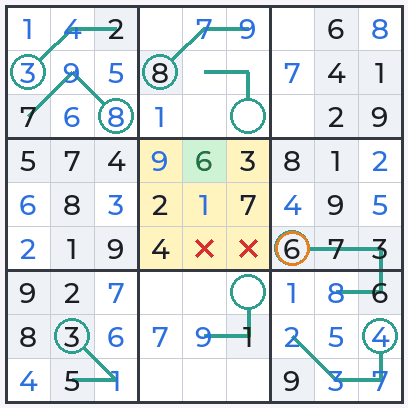

<!-- Written by tools/walkthrough.py average-lines: edit the script, not this page. -->
# Average Lines, step 34: the 6 in box 5

**Step 34 of 49** · [← Step 33](step-33.md) · [All steps](../average-lines.md#the-whole-puzzle-step-by-step) · [Step 35 →](step-35.md)

Box 5 needs a 6. r6c5 and r6c6: row 6 has one (r6c7). Only **r4c5** is left: **r4c5 = 6**.

**Step 34 of 49** · [← Step 33](step-33.md) · [All steps](../average-lines.md#the-whole-puzzle-step-by-step) · [Step 35 →](step-35.md)
