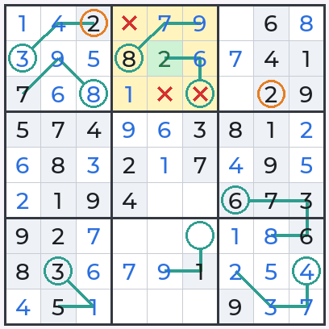

<!-- Written by tools/walkthrough.py average-lines: edit the script, not this page. -->
# Average Lines, step 36: the 2 in box 2

**Step 36 of 49** · [← Step 35](step-35.md) · [All steps](../average-lines.md#the-whole-puzzle-step-by-step) · [Step 37 →](step-37.md)

Box 2 needs a 2. r1c4: row 1 has one (r1c3). r3c5 and r3c6: row 3 has one (r3c8). Only **r2c5** is left: **r2c5 = 2**.

**Step 36 of 49** · [← Step 35](step-35.md) · [All steps](../average-lines.md#the-whole-puzzle-step-by-step) · [Step 37 →](step-37.md)
