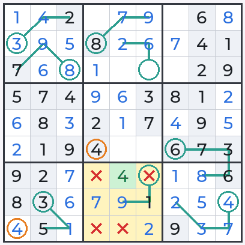

<!-- Written by tools/walkthrough.py average-lines: edit the script, not this page. -->
# Average Lines, step 38: the 4 in box 8

**Step 38 of 49** · [← Step 37](step-37.md) · [All steps](../average-lines.md#the-whole-puzzle-step-by-step) · [Step 39 →](step-39.md)

Box 8 needs a 4. r7c4: column 4 has one (r6c4). r9c4 and r9c5: row 9 has one (r9c1). r7c6: it's the circle: the line's 2 other digits add up to 10, so their average is 5. Only **r7c5** is left: **r7c5 = 4**.

**Step 38 of 49** · [← Step 37](step-37.md) · [All steps](../average-lines.md#the-whole-puzzle-step-by-step) · [Step 39 →](step-39.md)
