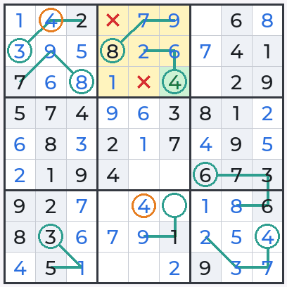

<!-- Written by tools/walkthrough.py average-lines: edit the script, not this page. -->
# Average Lines, step 39: the 4 in box 2

**Step 39 of 49** · [← Step 38](step-38.md) · [All steps](../average-lines.md#the-whole-puzzle-step-by-step) · [Step 40 →](step-40.md)

Box 2 needs a 4. r1c4: row 1 has one (r1c2). r3c5: column 5 has one (r7c5). Only **r3c6** is left: **r3c6 = 4**.

**Step 39 of 49** · [← Step 38](step-38.md) · [All steps](../average-lines.md#the-whole-puzzle-step-by-step) · [Step 40 →](step-40.md)
