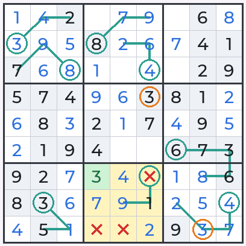

<!-- Written by tools/walkthrough.py average-lines: edit the script, not this page. -->
# Average Lines, step 40: the 3 in box 8

**Step 40 of 49** · [← Step 39](step-39.md) · [All steps](../average-lines.md#the-whole-puzzle-step-by-step) · [Step 41 →](step-41.md)

Box 8 needs a 3. r7c6: column 6 has one (r4c6). r9c4 and r9c5: row 9 has one (r9c8). Only **r7c4** is left: **r7c4 = 3**.

**Step 40 of 49** · [← Step 39](step-39.md) · [All steps](../average-lines.md#the-whole-puzzle-step-by-step) · [Step 41 →](step-41.md)
