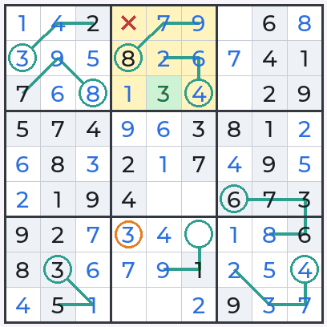

<!-- Written by tools/walkthrough.py average-lines: edit the script, not this page. -->
# Average Lines, step 41: the 3 in box 2

**Step 41 of 49** · [← Step 40](step-40.md) · [All steps](../average-lines.md#the-whole-puzzle-step-by-step) · [Step 42 →](step-42.md)

Box 2 needs a 3. r1c4: column 4 has one (r7c4). Only **r3c5** is left: **r3c5 = 3**.

**Step 41 of 49** · [← Step 40](step-40.md) · [All steps](../average-lines.md#the-whole-puzzle-step-by-step) · [Step 42 →](step-42.md)
