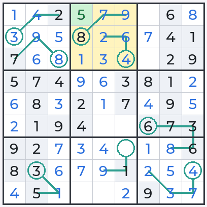

<!-- Written by tools/walkthrough.py average-lines: edit the script, not this page. -->
# Average Lines, step 42: the 5 in box 2

**Step 42 of 49** · [← Step 41](step-41.md) · [All steps](../average-lines.md#the-whole-puzzle-step-by-step) · [Step 43 →](step-43.md)

Box 2 needs a 5, and r1c4 is its last empty cell: **r1c4 = 5**.

**Step 42 of 49** · [← Step 41](step-41.md) · [All steps](../average-lines.md#the-whole-puzzle-step-by-step) · [Step 43 →](step-43.md)
