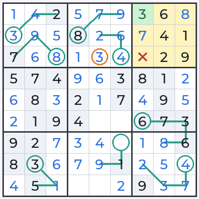

<!-- Written by tools/walkthrough.py average-lines: edit the script, not this page. -->
# Average Lines, step 43: the 3 in box 3

**Step 43 of 49** · [← Step 42](step-42.md) · [All steps](../average-lines.md#the-whole-puzzle-step-by-step) · [Step 44 →](step-44.md)

Box 3 needs a 3. r3c7: row 3 has one (r3c5). Only **r1c7** is left: **r1c7 = 3**.

**Step 43 of 49** · [← Step 42](step-42.md) · [All steps](../average-lines.md#the-whole-puzzle-step-by-step) · [Step 44 →](step-44.md)
