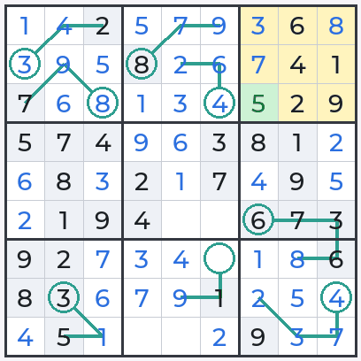

<!-- Written by tools/walkthrough.py average-lines: edit the script, not this page. -->
# Average Lines, step 44: the 5 in box 3

**Step 44 of 49** · [← Step 43](step-43.md) · [All steps](../average-lines.md#the-whole-puzzle-step-by-step) · [Step 45 →](step-45.md)

Box 3 needs a 5, and r3c7 is its last empty cell: **r3c7 = 5**.

**Step 44 of 49** · [← Step 43](step-43.md) · [All steps](../average-lines.md#the-whole-puzzle-step-by-step) · [Step 45 →](step-45.md)
