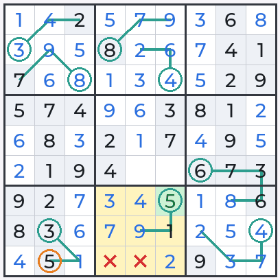

<!-- Written by tools/walkthrough.py average-lines: edit the script, not this page. -->
# Average Lines, step 45: the 5 in box 8

**Step 45 of 49** · [← Step 44](step-44.md) · [All steps](../average-lines.md#the-whole-puzzle-step-by-step) · [Step 46 →](step-46.md)

Box 8 needs a 5. r9c4 and r9c5: row 9 has one (r9c2). Only **r7c6** is left: **r7c6 = 5**.

**Step 45 of 49** · [← Step 44](step-44.md) · [All steps](../average-lines.md#the-whole-puzzle-step-by-step) · [Step 46 →](step-46.md)
