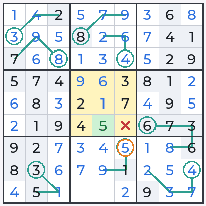

<!-- Written by tools/walkthrough.py average-lines: edit the script, not this page. -->
# Average Lines, step 46: the 5 in box 5

**Step 46 of 49** · [← Step 45](step-45.md) · [All steps](../average-lines.md#the-whole-puzzle-step-by-step) · [Step 47 →](step-47.md)

Box 5 needs a 5. r6c6: column 6 has one (r7c6). Only **r6c5** is left: **r6c5 = 5**.

**Step 46 of 49** · [← Step 45](step-45.md) · [All steps](../average-lines.md#the-whole-puzzle-step-by-step) · [Step 47 →](step-47.md)
