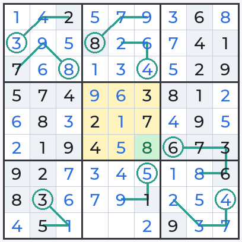

<!-- Written by tools/walkthrough.py average-lines: edit the script, not this page. -->
# Average Lines, step 47: the 8 in box 5

**Step 47 of 49** · [← Step 46](step-46.md) · [All steps](../average-lines.md#the-whole-puzzle-step-by-step) · [Step 48 →](step-48.md)

Box 5 needs an 8, and r6c6 is its last empty cell: **r6c6 = 8**.

**Step 47 of 49** · [← Step 46](step-46.md) · [All steps](../average-lines.md#the-whole-puzzle-step-by-step) · [Step 48 →](step-48.md)
