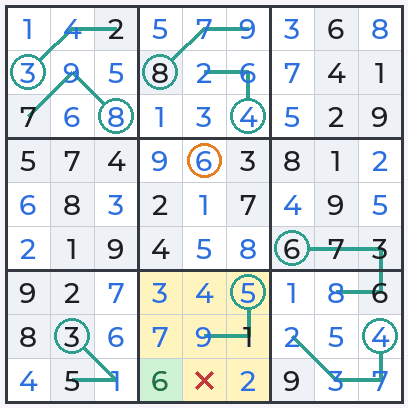

<!-- Written by tools/walkthrough.py average-lines: edit the script, not this page. -->
# Average Lines, step 48: the 6 in box 8

**Step 48 of 49** · [← Step 47](step-47.md) · [All steps](../average-lines.md#the-whole-puzzle-step-by-step) · [Step 49 →](step-49.md)

Box 8 needs a 6. r9c5: column 5 has one (r4c5). Only **r9c4** is left: **r9c4 = 6**.

**Step 48 of 49** · [← Step 47](step-47.md) · [All steps](../average-lines.md#the-whole-puzzle-step-by-step) · [Step 49 →](step-49.md)
