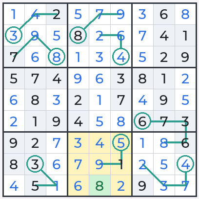

<!-- Written by tools/walkthrough.py average-lines: edit the script, not this page. -->
# Average Lines, step 49: the 8 in box 8

**Step 49 of 49** · [← Step 48](step-48.md) · [All steps](../average-lines.md#the-whole-puzzle-step-by-step) · [All steps](../average-lines.md#the-whole-puzzle-step-by-step)

Box 8 needs an 8, and r9c5 is its last empty cell: **r9c5 = 8**.

Solved.

**Step 49 of 49** · [← Step 48](step-48.md) · [All steps](../average-lines.md#the-whole-puzzle-step-by-step) · [All steps](../average-lines.md#the-whole-puzzle-step-by-step)
