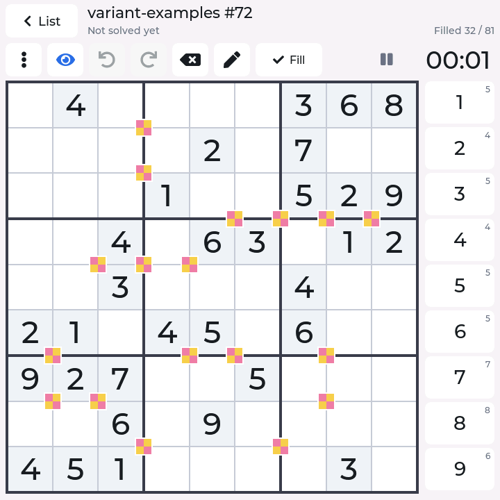
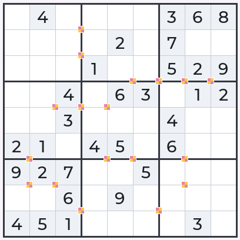

# Battenburg

[← All variants](README.md) · [Puzzles](../features-puzzles.md) · [How to play](../how-to-play.md)

## The rules

[Classic](classic.md) rules, and **marks where four cells meet**, each a little pink and yellow square like the cake: those four cells' digits make a **checkerboard of odd and even**: the two across the corner from each other alike, the two side by side not (2 7 / 5 8: even, odd / odd, even). **Every mark is shown**, so four cells without a mark are no checkerboard.

## On the board

- The marks sit on the corner the four cells share.
- A marked block with two cells that already break the pattern (two neighbours alike, or two across the corner unlike), or a full unmarked block that is a checkerboard, turns red.
- The grader and hints know one step: in a marked block a cell takes the parity its partner across the corner can have and the other one from its neighbours; in an unmarked block whose other three cells are set for a checkerboard, the fourth takes the parity that breaks it.
- **Puzzles → ⋮ → New puzzle → Marks → Battenburg**: every checkerboard on the solution gets its mark, usually 9 to 12.

## How to solve it

- **Across the corner: alike.** In a marked block, one odd digit makes the cell across the corner odd and both its neighbours even.
- **No mark is a clue.** Three cells of an unmarked block in a checkerboard's pattern (say odd, even / even, _) leave the fourth the other parity: it mustn't finish the pattern.
- **Count odd and even.** Each row, column and box holds five odd digits and four even ones: a few marks fixing parities can leave a digit only one place.

## Worked example

**variant-examples #72**, Battenburg Easy (see [Classic](classic.md#worked-example-the-whole-puzzle) for how to import the examples; cells are written r*row*c*column*).

**Step 1: r4c7.** By the Classic rules it could be 8 or 9 (row 4 has 4, 6, 3, 1 and 2; column 7 has 3, 7, 5, 4 and 6). The block r3c7, r3c8 / r4c7, r4c8 has a mark: 5 2 / _ 1. r4c7 is across the corner from the 2, so it's even like it (and unlike its neighbours, the 5 and the 1). **r4c7 = 8**.

**Step 2: r6c3.** By the Classic rules it could be 8 or 9. The block r6c2, r6c3 / r7c2, r7c3 reads 1 _ / 2 7 and has **no** mark. An 8 there would make it odd, even / even, odd: a checkerboard, which would have a mark. **r6c3 = 9**.

## The whole puzzle, step by step

<!-- walkthrough -->
<!-- Written by tools/walkthrough.py battenburg: edit the script, not this part. -->

The whole puzzle, from the start to the last cell: 49 steps, each one a single (one place left for a digit, or one digit left for a cell), taken in the order a box's single comes first, so not quite the order of the worked example above. Each step has a page of its own, with **Previous** and **Next**: pick its number below. In each picture, the unit the step looks at is tinted yellow (for a cell with one digit left: its row, column and box), the new digit is on green, the digits that rule cells out have an **orange ring**, and the empty cells they rule out a **red cross**. Givens are on grey, digits from earlier steps in blue.

| [1](battenburg/step-01.md) | [2](battenburg/step-02.md) | [3](battenburg/step-03.md) | [4](battenburg/step-04.md) | [5](battenburg/step-05.md) | [6](battenburg/step-06.md) | [7](battenburg/step-07.md) | [8](battenburg/step-08.md) | [9](battenburg/step-09.md) | [10](battenburg/step-10.md) |
|:-:|:-:|:-:|:-:|:-:|:-:|:-:|:-:|:-:|:-:|
| [11](battenburg/step-11.md) | [12](battenburg/step-12.md) | [13](battenburg/step-13.md) | [14](battenburg/step-14.md) | [15](battenburg/step-15.md) | [16](battenburg/step-16.md) | [17](battenburg/step-17.md) | [18](battenburg/step-18.md) | [19](battenburg/step-19.md) | [20](battenburg/step-20.md) |
| [21](battenburg/step-21.md) | [22](battenburg/step-22.md) | [23](battenburg/step-23.md) | [24](battenburg/step-24.md) | [25](battenburg/step-25.md) | [26](battenburg/step-26.md) | [27](battenburg/step-27.md) | [28](battenburg/step-28.md) | [29](battenburg/step-29.md) | [30](battenburg/step-30.md) |
| [31](battenburg/step-31.md) | [32](battenburg/step-32.md) | [33](battenburg/step-33.md) | [34](battenburg/step-34.md) | [35](battenburg/step-35.md) | [36](battenburg/step-36.md) | [37](battenburg/step-37.md) | [38](battenburg/step-38.md) | [39](battenburg/step-39.md) | [40](battenburg/step-40.md) |
| [41](battenburg/step-41.md) | [42](battenburg/step-42.md) | [43](battenburg/step-43.md) | [44](battenburg/step-44.md) | [45](battenburg/step-45.md) | [46](battenburg/step-46.md) | [47](battenburg/step-47.md) | [48](battenburg/step-48.md) | [49](battenburg/step-49.md) |  |

Solved.

<!-- /walkthrough -->
