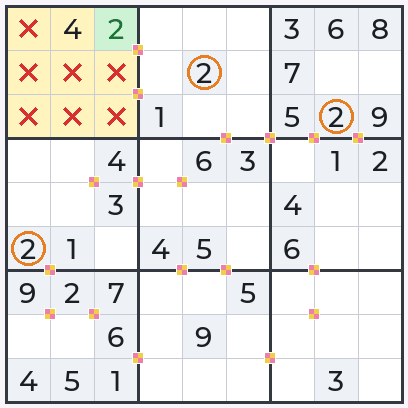

<!-- Written by tools/walkthrough.py battenburg: edit the script, not this page. -->
# Battenburg, step 1: the 2 in box 1

**Step 1 of 49** · [← The start](../battenburg.md#the-whole-puzzle-step-by-step) · [All steps](../battenburg.md#the-whole-puzzle-step-by-step) · [Step 2 →](step-02.md)

Box 1 needs a 2. r1c1: column 1 has one (r6c1). r2c1, r2c2 and r2c3: row 2 has one (r2c5). r3c1, r3c2 and r3c3: row 3 has one (r3c8). Only **r1c3** is left: **r1c3 = 2**.

**Step 1 of 49** · [← The start](../battenburg.md#the-whole-puzzle-step-by-step) · [All steps](../battenburg.md#the-whole-puzzle-step-by-step) · [Step 2 →](step-02.md)
