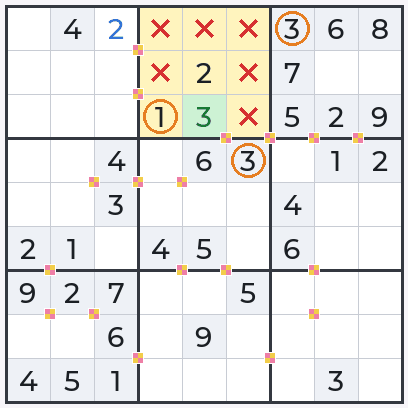

<!-- Written by tools/walkthrough.py battenburg: edit the script, not this page. -->
# Battenburg, step 2: the 3 in box 2

**Step 2 of 49** · [← Step 1](step-01.md) · [All steps](../battenburg.md#the-whole-puzzle-step-by-step) · [Step 3 →](step-03.md)

Box 2 needs a 3. r1c4, r1c5 and r1c6: row 1 has one (r1c7). r2c6 and r3c6: column 6 has one (r4c6). r2c4: a mark checkers its 2x2 block with r3c4, beside it, which is 1: it's the other kind, not odd. Only **r3c5** is left: **r3c5 = 3**.

**Step 2 of 49** · [← Step 1](step-01.md) · [All steps](../battenburg.md#the-whole-puzzle-step-by-step) · [Step 3 →](step-03.md)
