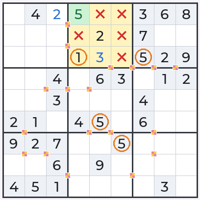

<!-- Written by tools/walkthrough.py battenburg: edit the script, not this page. -->
# Battenburg, step 3: the 5 in box 2

**Step 3 of 49** · [← Step 2](step-02.md) · [All steps](../battenburg.md#the-whole-puzzle-step-by-step) · [Step 4 →](step-04.md)

Box 2 needs a 5. r1c5: column 5 has one (r6c5). r1c6 and r2c6: column 6 has one (r7c6). r3c6: row 3 has one (r3c7). r2c4: a mark checkers its 2x2 block with r3c4, beside it, which is 1: it's the other kind, not odd. Only **r1c4** is left: **r1c4 = 5**.

**Step 3 of 49** · [← Step 2](step-02.md) · [All steps](../battenburg.md#the-whole-puzzle-step-by-step) · [Step 4 →](step-04.md)
