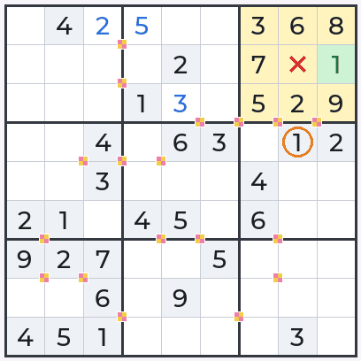

<!-- Written by tools/walkthrough.py battenburg: edit the script, not this page. -->
# Battenburg, step 4: the 1 in box 3

**Step 4 of 49** · [← Step 3](step-03.md) · [All steps](../battenburg.md#the-whole-puzzle-step-by-step) · [Step 5 →](step-05.md)

Box 3 needs a 1. r2c8: column 8 has one (r4c8). Only **r2c9** is left: **r2c9 = 1**.

**Step 4 of 49** · [← Step 3](step-03.md) · [All steps](../battenburg.md#the-whole-puzzle-step-by-step) · [Step 5 →](step-05.md)
