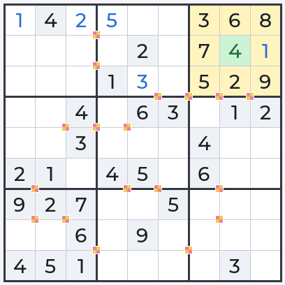

<!-- Written by tools/walkthrough.py battenburg: edit the script, not this page. -->
# Battenburg, step 6: the 4 in box 3

**Step 6 of 49** · [← Step 5](step-05.md) · [All steps](../battenburg.md#the-whole-puzzle-step-by-step) · [Step 7 →](step-07.md)

Box 3 needs a 4, and r2c8 is its last empty cell: **r2c8 = 4**.

**Step 6 of 49** · [← Step 5](step-05.md) · [All steps](../battenburg.md#the-whole-puzzle-step-by-step) · [Step 7 →](step-07.md)
