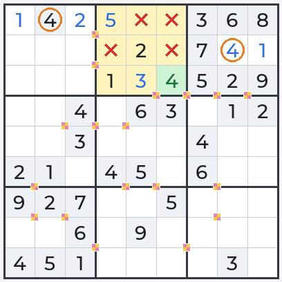

<!-- Written by tools/walkthrough.py battenburg: edit the script, not this page. -->
# Battenburg, step 7: the 4 in box 2

**Step 7 of 49** · [← Step 6](step-06.md) · [All steps](../battenburg.md#the-whole-puzzle-step-by-step) · [Step 8 →](step-08.md)

Box 2 needs a 4. r1c5 and r1c6: row 1 has one (r1c2). r2c4 and r2c6: row 2 has one (r2c8). Only **r3c6** is left: **r3c6 = 4**.

**Step 7 of 49** · [← Step 6](step-06.md) · [All steps](../battenburg.md#the-whole-puzzle-step-by-step) · [Step 8 →](step-08.md)
