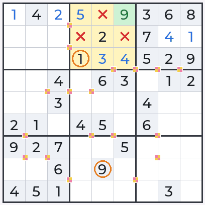

<!-- Written by tools/walkthrough.py battenburg: edit the script, not this page. -->
# Battenburg, step 8: the 9 in box 2

**Step 8 of 49** · [← Step 7](step-07.md) · [All steps](../battenburg.md#the-whole-puzzle-step-by-step) · [Step 9 →](step-09.md)

Box 2 needs a 9. r1c5: column 5 has one (r8c5). r2c4: a mark checkers its 2x2 block with r3c4, beside it, which is 1: it's the other kind, not odd. r2c6: its 2x2 block with 2 in r2c5, 3 in r3c5 and 4 in r3c6 has no mark, and a 9 would make it a checkerboard of odd and even. Only **r1c6** is left: **r1c6 = 9**.

**Step 8 of 49** · [← Step 7](step-07.md) · [All steps](../battenburg.md#the-whole-puzzle-step-by-step) · [Step 9 →](step-09.md)
