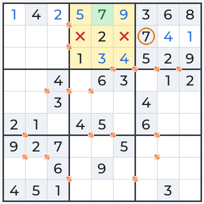

<!-- Written by tools/walkthrough.py battenburg: edit the script, not this page. -->
# Battenburg, step 9: the 7 in box 2

**Step 9 of 49** · [← Step 8](step-08.md) · [All steps](../battenburg.md#the-whole-puzzle-step-by-step) · [Step 10 →](step-10.md)

Box 2 needs a 7. r2c4 and r2c6: row 2 has one (r2c7). Only **r1c5** is left: **r1c5 = 7**.

**Step 9 of 49** · [← Step 8](step-08.md) · [All steps](../battenburg.md#the-whole-puzzle-step-by-step) · [Step 10 →](step-10.md)
