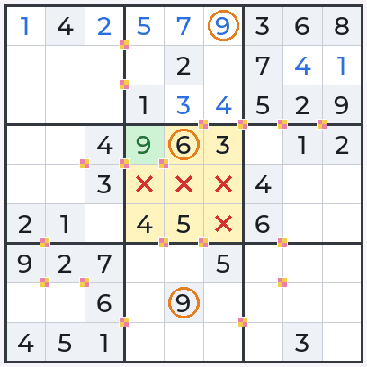

<!-- Written by tools/walkthrough.py battenburg: edit the script, not this page. -->
# Battenburg, step 10: the 9 in box 5

**Step 10 of 49** · [← Step 9](step-09.md) · [All steps](../battenburg.md#the-whole-puzzle-step-by-step) · [Step 11 →](step-11.md)

Box 5 needs a 9. r5c5: column 5 has one (r8c5). r5c6 and r6c6: column 6 has one (r1c6). r5c4: a mark checkers its 2x2 block with r4c5, across the corner from it, which is 6: it's even too. Only **r4c4** is left: **r4c4 = 9**.

**Step 10 of 49** · [← Step 9](step-09.md) · [All steps](../battenburg.md#the-whole-puzzle-step-by-step) · [Step 11 →](step-11.md)
