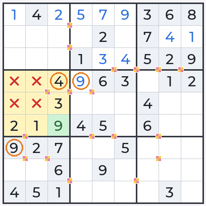

<!-- Written by tools/walkthrough.py battenburg: edit the script, not this page. -->
# Battenburg, step 11: the 9 in box 4

**Step 11 of 49** · [← Step 10](step-10.md) · [All steps](../battenburg.md#the-whole-puzzle-step-by-step) · [Step 12 →](step-12.md)

Box 4 needs a 9. r4c1 and r4c2: row 4 has one (r4c4). r5c1: column 1 has one (r7c1). r5c2: a mark checkers its 2x2 block with r4c3, across the corner from it, which is 4: it's even too. Only **r6c3** is left: **r6c3 = 9**.

**Step 11 of 49** · [← Step 10](step-10.md) · [All steps](../battenburg.md#the-whole-puzzle-step-by-step) · [Step 12 →](step-12.md)
