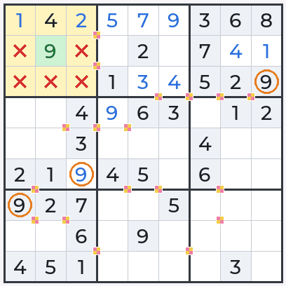

<!-- Written by tools/walkthrough.py battenburg: edit the script, not this page. -->
# Battenburg, step 12: the 9 in box 1

**Step 12 of 49** · [← Step 11](step-11.md) · [All steps](../battenburg.md#the-whole-puzzle-step-by-step) · [Step 13 →](step-13.md)

Box 1 needs a 9. r2c1: column 1 has one (r7c1). r2c3: column 3 has one (r6c3). r3c1, r3c2 and r3c3: row 3 has one (r3c9). Only **r2c2** is left: **r2c2 = 9**.

**Step 12 of 49** · [← Step 11](step-11.md) · [All steps](../battenburg.md#the-whole-puzzle-step-by-step) · [Step 13 →](step-13.md)
