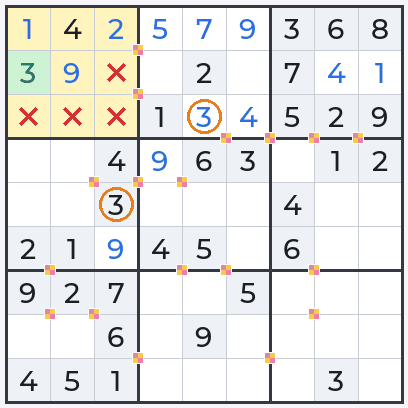

<!-- Written by tools/walkthrough.py battenburg: edit the script, not this page. -->
# Battenburg, step 13: the 3 in box 1

**Step 13 of 49** · [← Step 12](step-12.md) · [All steps](../battenburg.md#the-whole-puzzle-step-by-step) · [Step 14 →](step-14.md)

Box 1 needs a 3. r2c3: column 3 has one (r5c3). r3c1, r3c2 and r3c3: row 3 has one (r3c5). Only **r2c1** is left: **r2c1 = 3**.

**Step 13 of 49** · [← Step 12](step-12.md) · [All steps](../battenburg.md#the-whole-puzzle-step-by-step) · [Step 14 →](step-14.md)
