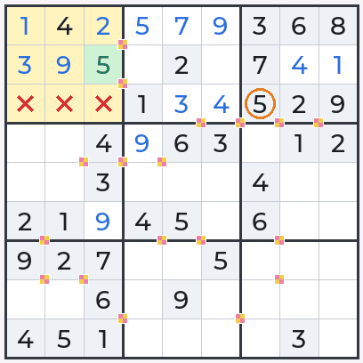

<!-- Written by tools/walkthrough.py battenburg: edit the script, not this page. -->
# Battenburg, step 14: the 5 in box 1

**Step 14 of 49** · [← Step 13](step-13.md) · [All steps](../battenburg.md#the-whole-puzzle-step-by-step) · [Step 15 →](step-15.md)

Box 1 needs a 5. r3c1, r3c2 and r3c3: row 3 has one (r3c7). Only **r2c3** is left: **r2c3 = 5**.

**Step 14 of 49** · [← Step 13](step-13.md) · [All steps](../battenburg.md#the-whole-puzzle-step-by-step) · [Step 15 →](step-15.md)
