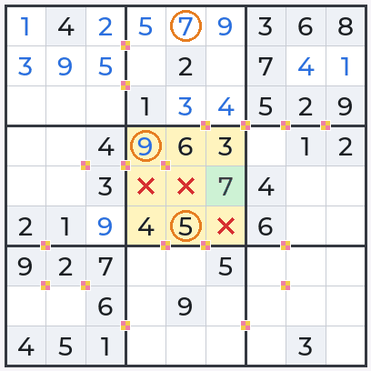

<!-- Written by tools/walkthrough.py battenburg: edit the script, not this page. -->
# Battenburg, step 15: the 7 in box 5

**Step 15 of 49** · [← Step 14](step-14.md) · [All steps](../battenburg.md#the-whole-puzzle-step-by-step) · [Step 16 →](step-16.md)

Box 5 needs a 7. r5c5: column 5 has one (r1c5). r5c4: a mark checkers its 2x2 block with r4c4, beside it, which is 9: it's the other kind, not odd. r6c6: a mark checkers its 2x2 block with r6c5, beside it, which is 5: it's the other kind, not odd. Only **r5c6** is left: **r5c6 = 7**.

**Step 15 of 49** · [← Step 14](step-14.md) · [All steps](../battenburg.md#the-whole-puzzle-step-by-step) · [Step 16 →](step-16.md)
