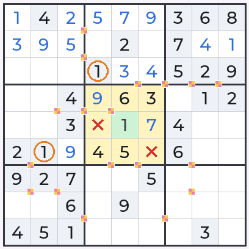

<!-- Written by tools/walkthrough.py battenburg: edit the script, not this page. -->
# Battenburg, step 16: the 1 in box 5

**Step 16 of 49** · [← Step 15](step-15.md) · [All steps](../battenburg.md#the-whole-puzzle-step-by-step) · [Step 17 →](step-17.md)

Box 5 needs a 1. r5c4: column 4 has one (r3c4). r6c6: row 6 has one (r6c2). Only **r5c5** is left: **r5c5 = 1**.

**Step 16 of 49** · [← Step 15](step-15.md) · [All steps](../battenburg.md#the-whole-puzzle-step-by-step) · [Step 17 →](step-17.md)
