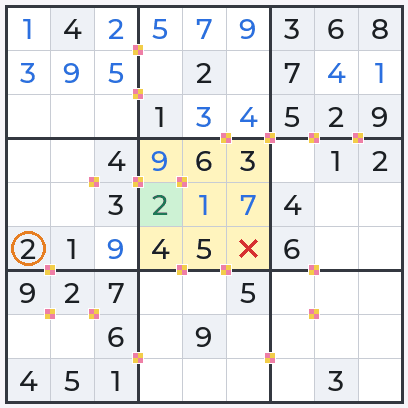

<!-- Written by tools/walkthrough.py battenburg: edit the script, not this page. -->
# Battenburg, step 17: the 2 in box 5

**Step 17 of 49** · [← Step 16](step-16.md) · [All steps](../battenburg.md#the-whole-puzzle-step-by-step) · [Step 18 →](step-18.md)

Box 5 needs a 2. r6c6: row 6 has one (r6c1). Only **r5c4** is left: **r5c4 = 2**.

**Step 17 of 49** · [← Step 16](step-16.md) · [All steps](../battenburg.md#the-whole-puzzle-step-by-step) · [Step 18 →](step-18.md)
